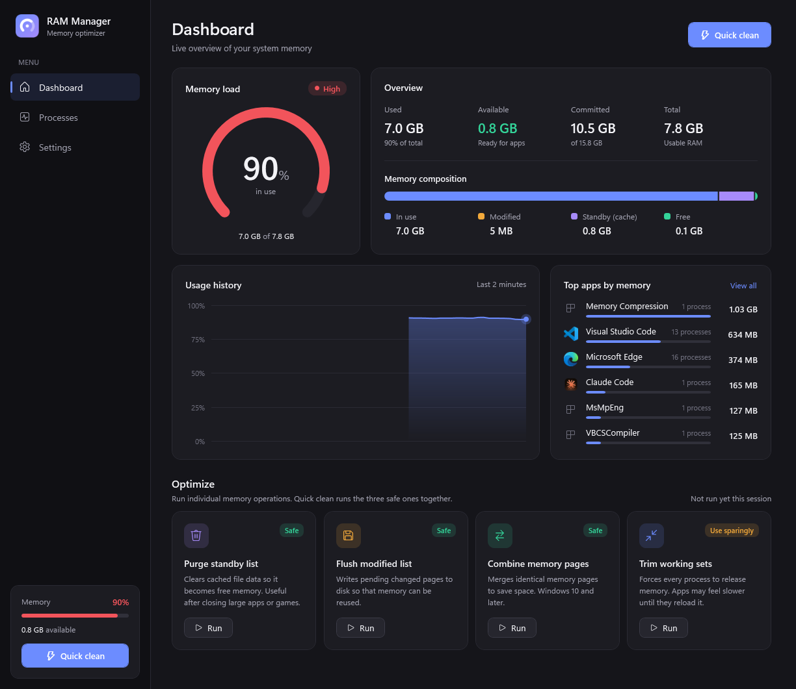
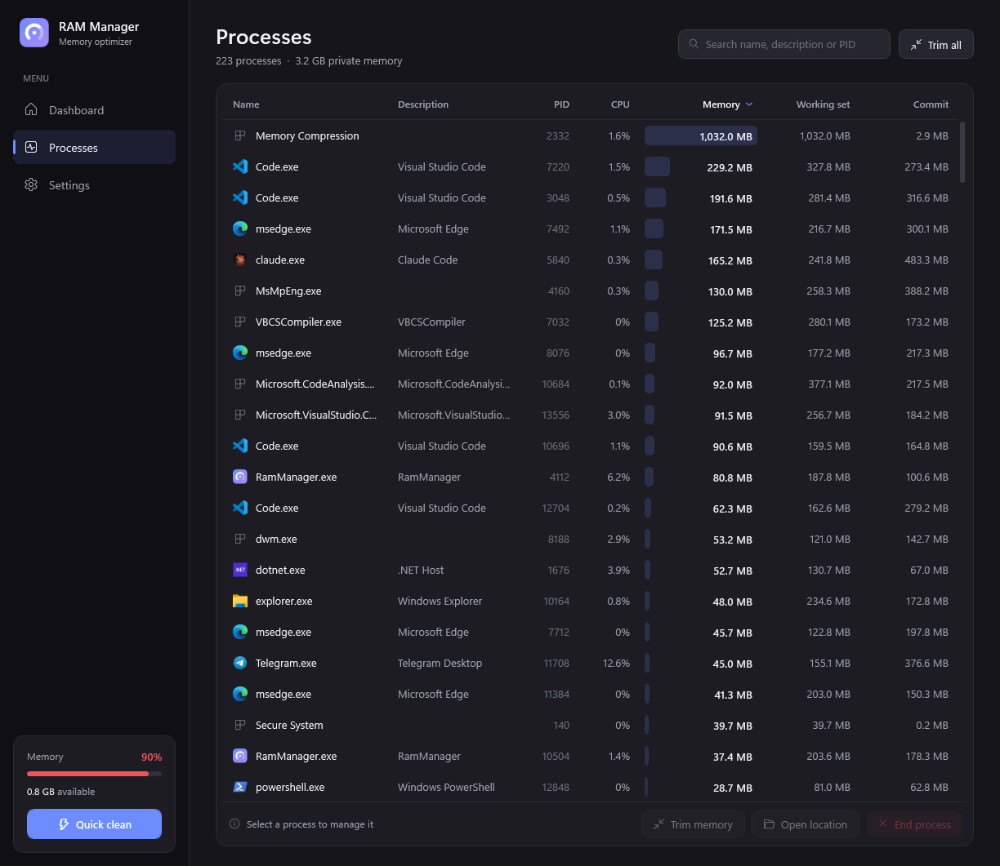
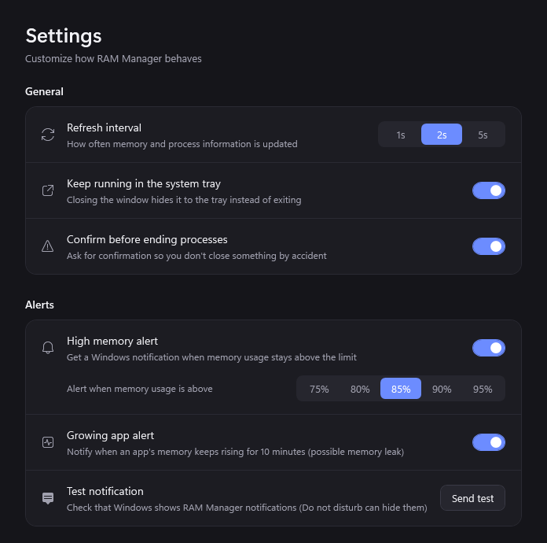

# RAM Manager

A lightweight Windows memory monitor and optimizer built with C# / .NET 10 and WPF.



## Screenshots

### Processes
Every running process with its icon, CPU, and memory usage. Sort, search, trim memory, or end a process.



### Settings and alerts
Choose the refresh interval, tray behavior and high-RAM alert limit.



## Features

- **Dashboard**: live memory load gauge, used / available / committed / total, memory
  composition (in use, modified, standby cache, free), usage history chart, and the top apps by memory
  (grouped, e.g. all Chrome processes together).
- **Processes**: every process with icon, description, CPU, private memory, working set and commit.
  Sort, search, trim memory, open file location, or end a process. Critical system processes are protected.
- **Cleaning** (needs administrator):
  - *Quick clean*: flush modified list + purge standby list + combine memory pages
  - *Purge standby list*: clears the file cache
  - *Flush modified list*: writes pending pages to disk
  - *Combine memory pages*: merges identical pages
  - *Trim working sets*: forces processes to release memory (use sparingly; apps may slow down briefly)
- **System tray**: icon shows the current memory % (green / amber / red), with Quick clean and Exit in the menu.
  Closing the window keeps it running in the tray.
- **High-RAM alerts** (Windows notifications, also while in the tray):
  - *High memory*: memory stays above your limit (75–95%, default 85%) for 10 seconds
  - *Growing app*: an app's memory keeps rising for 10 minutes (possible memory leak)
  - Clicking a notification opens the relevant page; a test button checks notifications work
- **Settings**: refresh interval (1s / 2s / 5s), close to tray, confirm before ending processes, alerts.
  Saved to `%AppData%\RamManager\settings.json`.

## Build & run

Requires the .NET 10 SDK.

```powershell
# Run (prompts for administrator via UAC)
dotnet run -c Release

# Publish a single exe to .\publish (needs the .NET 10 Desktop Runtime on the target PC)
dotnet publish -c Release -r win-x64 --self-contained false -p:PublishSingleFile=true -o publish
```

### Development without UAC

```powershell
dotnet build -p:NoAdmin=true
```

This uses `app.dev.manifest`, so the app runs without elevation. Monitoring works but cleaning is disabled.
In Debug builds, `RamManager.exe --screenshot <folder>` renders each page to PNG and exits
(used for the screenshots in `docs/screenshots`).

## Project layout

```
Native/       Win32 / NT API declarations (P/Invoke)
Services/     MemoryService, MemoryCleaner, ProcessService, SettingsService, TrayIconService, PrivilegeHelper
ViewModels/   MVVM view models (Main, Dashboard, Processes, Settings)
Controls/     Custom-drawn RingGauge, HistoryChart, MemoryCompositionBar
Views/        MainWindow, Dashboard, Processes, Settings, ConfirmDialog
Themes/       Dark theme and control styles
```

## Notes

- Windows already manages memory well. Standby memory is a cache that is reused instantly, so
  "available" memory is what matters. Cleaning is most useful after closing heavy apps or games.
- Process data comes from one `NtQuerySystemInformation` call per refresh, and only while the window is
  visible. In the tray, the app only reads memory totals and releases its own working set.
